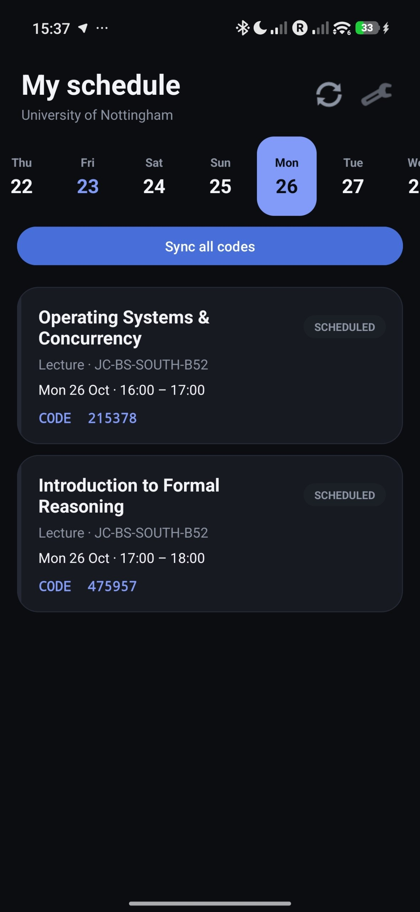
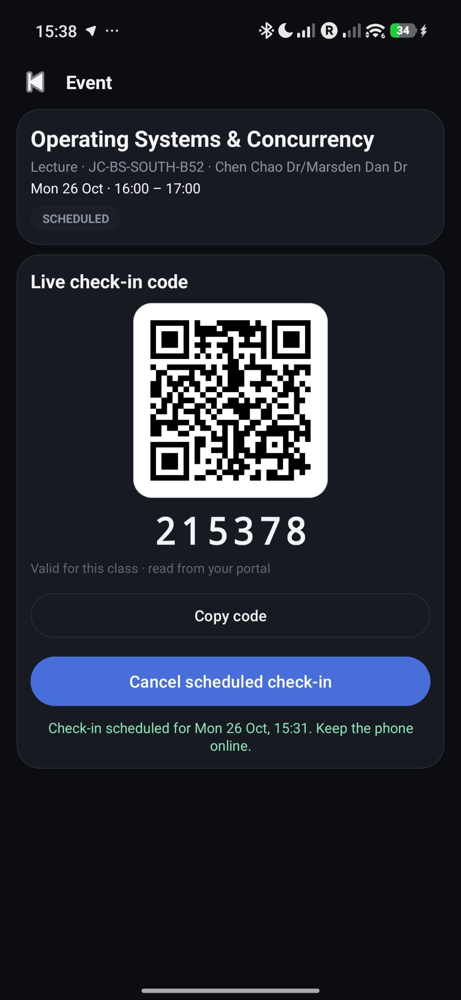
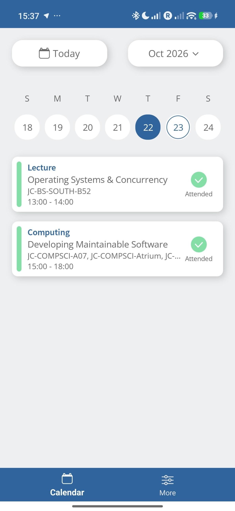
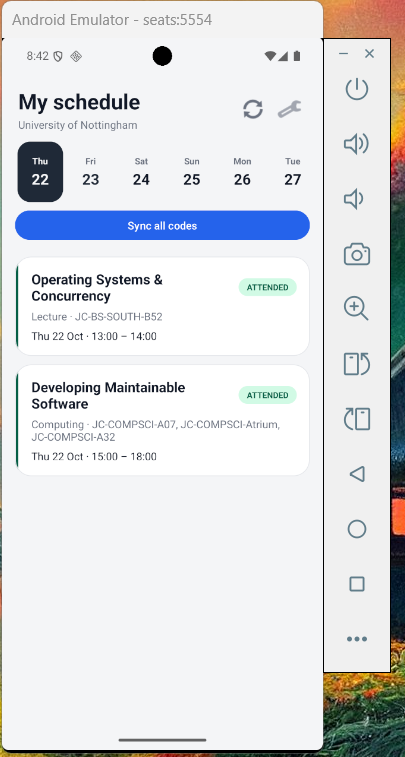
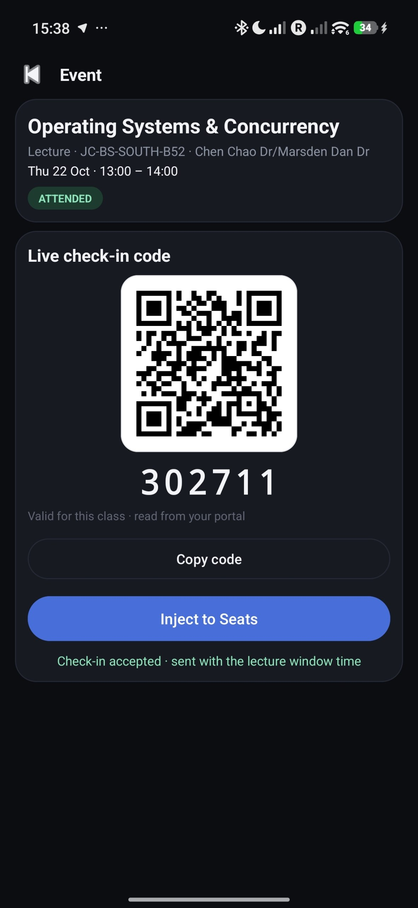
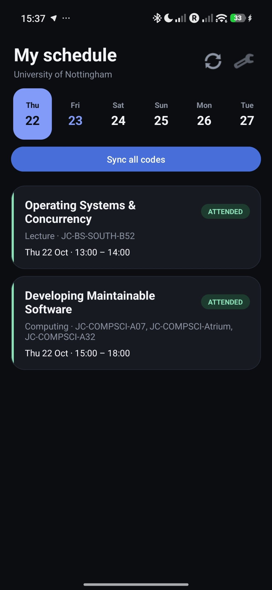

# !PURELY OUT OF THE KINDNESS OF MY HEART AND MY IMPECCABLE ETHICS!

# I reported this exploit to the UoN staff team the moment I released it, as if a member of the red team! Since 06.11.2026, this loophole has been patched - the version currently available on GitHub no longer retrieves past or future check-in codes!


---

# SEAtS Unlocked

Android client and protocol reference for SEAtS attendance systems. The app displays timetables and check-in codes and submits immediate, past or scheduled check-ins. Base application is linked with University of Nottingham, however can be modified for any other establishment.

## Screenshots

| Future codes | Scheduled check-in |
|---|---|
|  |  |

| Official app after check-in | Android emulator |
|---|---|
|  |  |

| Expired check-in | Yesterday check-in |
|---|---|
|  |  |


## Quick start

1. Install [SeatsUnlocked-v1.11-beta.apk](dist/SeatsUnlocked-v1.11-beta.apk) (or go to [Releases](https://github.com/MS-Mesh/SEAtS-Unlocked/releases)).
2. Sign in with your university Microsoft account.
3. Tap **Sync all codes** and sign in to the tenant portal.
4. Open a class and tap **Inject to Seats** or **Copy code**. Check-ins are sent immediately during the window, backdated for past classes, or scheduled for future classes.

## Reverse engineering process

### What was recovered

| Area | Result |
|---|---|
| Live-code algorithm | MurmurHash2 x86_32 + Damm check digit over `seed + counter` |
| Request fingerprint | HMAC-SHA256, big-endian, key derived from the tenant `MobilePhone` setting |
| Student API | OIDC/PKCE, events, settings, clock, check-in |
| Portal path | Microsoft SAML session + `QrProxy/GetCheckInCode` static Class Code |
| Attendance semantics | timestamp-driven clocking, window enforcement, status mapping |
| Future check-in | no student-accessible immediate path found; schedule at the window |

### 1. Login (OIDC + PKCE)

```
https://idv2.seats.cloud/connect/authorize
  ?client_id=seatsmaui.code.pkce
  &redirect_uri=seatsmobileapp://callback
  &response_type=code
  &scope=openid profile email SEAtSMobile SEAtS.profile offline_access
  &code_challenge=<S256>
  &code_challenge_method=S256
  &state=<random>
  &nonce=<random>
  &login_hint=<university email>
```

The browser returns `seatsmobileapp://callback?code=...&state=...`; the app exchanges the code at
`/connect/token` and reads `/connect/userinfo`. **`MobileGwEndpoint`** selects the tenant's mobile
API host.

| Tenant | client_id |
|---|---|
| University of Nottingham | `seatsmaui.code.pkce` |
| Default / other tenants | `seatsmaui.code.pkce.v2` |

### 2. Live-code algorithm

Used when the tenant returns a non-empty `checkinCode` seed in the event payload.

```
counter = floor((now - startCutoff) / duration)
value   = seed + counter
hash    = MurmurHash2_x86_32(int64_le(value), 0xC58F1A7A)
head    = hash % 100000
code    = head + DammDigit(head)
```

`duration` is `AutorefreshingQrDurationSecs` (20 s at UoN). The QR payload is
`https://seatssoftware.com/qr/<code>`; the official `QrParser` accepts any host with the path
`/qr/<6 digits>`.

Test vectors, seed `832105`:

| Counter | Code |
|---:|---|
| 0 | 980580 |
| 1 | 719256 |
| 12345 | 183613 |
| 999999 | 165845 |

Reference implementations: [seats_code.py](reverse/algorithm/seats_code.py),
[SeatsCode.java](reverse/algorithm/SeatsCode.java). Damm self-check: `855824` is valid.

### 3. Fingerprint (`?fp=`)

```
key    = SHA256(hex(MobilePhone) || 0D92EC24CEDDE505)[0:8]
digest = HMAC-SHA256(key, message)
fp     = big-endian uint64 of digest[0:8]

message = Timestamp|TimetableId|StudentScheduleId|CheckInReason|CheckInInput|MobileId|StudentId
```

`Timestamp` and `StartCutoffTime` are UTC `yyyy-MM-ddTHH:mm:ss` without a zone suffix. Empty
values are skipped. `StartCutoffTime`, `RoomsIds`, `IsCheckOut` and coordinates are not in the
`CheckInWithCode` fingerprint map. `StudentId` is appended last.

The property order is derived from SHA-256 prefixes of the DTO property names:

| Property | SHA-256 prefix |
|---|---|
| `Timestamp` | `115A2CC9` |
| `TimetableId` | `832C3C79` |
| `StudentScheduleId` | `8E764926` |
| `CheckInReason` | `5B483E37` |
| `CheckInInput` | `D7BEF11C` |
| `Uuid` | `437562BB` |
| `MobileId` | `E230C682` |
| `RoomsIds` | `AEF55036` |
| `Devices` | `4BA5121D` |
| `StudentId` | `517B2762` |

Test vector:

```
message = "2026-10-22T12:00:00|1234567|7654321|Qr|302711|device-id|12345"
MobilePhone = "0011223344556677"
fp = 10686439190112768140
```

Reference: [fingerprint.py](reverse/algorithm/fingerprint.py).

> A plain `SHA256(message || key)` with little-endian output is wrong and returns
> `400 Inconsistent parameters`. This was the hardest bug in the project.

### 4. Portal path (University of Nottingham)

The mobile API returns `"checkinCode": ""` because `QrCloudVerificationEnabled=true`. The web
portal still exposes a static Class Code:

```
GET https://<tenant>.seats.cloud/api/QrProxy/GetCheckInCode?id=<timetableId>
→ 200 "302711"
```

The Angular lecturer page is guarded client-side by `security(Lectures, QrCode)`, but the API
only checks that a portal session exists. The app signs into the portal in a WebView and runs a
same-origin fetch, so the HttpOnly session cookie is attached automatically:

```js
fetch('/api/QrProxy/GetCheckInCode?id=' + timetableId, { credentials: 'include' })
  .then(r => r.text())
  .then(code => bridge.bulk(JSON.stringify({ [timetableId]: code })));
```

The value is static for the whole lesson. It was observed unchanged over 30 seconds, after the
lecture and for future lectures (six were fetched in advance; `452290` for a 15:00 lecture was
accepted at 14:16).

The portal's **Live Code** tab is a separate presentation layer: it calls
`QrProxy/GetQrCodeIdentifier` every 20 seconds and renders
`/qrProxy/getFile?id=<identifier>&isRoom=false`. With the **raw `TimeZoneInfo` JSON string**
(not the parsed object) both `SetRemainder` and `GetQrCodeIdentifier` return `200` for a future
timetable, but the returned identifier (e.g. `577760`) is **not** a valid check-in code
(`isValid:false`) and the image endpoint is `403/404`. They do not open the attendance window.

**Bulk sync.** The app loops over every upcoming `timetableId` inside one WebView session and
caches the codes in `SharedPreferences`. The first schedule load without codes triggers the same
flow once; **Sync all codes** reruns it manually.

### 5. Check-in window semantics

The server creates a `clocking`; a background processor applies it using the clocking's
`Timestamp` and the timetable window (`startCutoff`–`endCutoff`):

| Situation | Result |
|---|---|
| Inside the window, timestamp = now | Applied; `swipeInDateTime` set; event becomes Attended |
| Past lecture, timestamp inside its old window | Applied in ~15 s; event becomes Attended |
| Future lecture, timestamp in the future | Clocking stays unprocessed; event remains Scheduled |
| Future lecture, timestamp = now | Queued but outside the future window; not applied |
| Past lecture, timestamp after the window | Queued; attendance is not applied |

`isValid: true` only means the code is correct. Attendance is confirmed by
`studentSchedule.swipeInDateTime` (or status 2/3/7), not by top-level `success` or `isValid`.

The app therefore sends immediately inside the window, backdates `start + 5 minutes` for a past
lecture, and schedules a future lecture with `AlarmManager` at `startCutoff + 60 seconds`.

Status ids: `1 Absent`, `2 Late`, `3 Attended`, `4 Scheduled`, `5 MarkedAsAbsent`,
`6 MarkedAsLate`, `7 MarkedAsAttended`, `8 AuthorisedAbsent`, `9 Cancelled`,
`10 AttendedOtherLecture`, `11 Unexpected`, `12 SwipedElsewhere`, `13 Unscheduled`.

### 6. Student API and flags

Base URL: `MobileGwEndpoint`, e.g. `https://01v2mobileapi.seats.cloud`.

| Method | Path | Use |
|---|---|---|
| GET | `/api/v3/students/myself/events?startDate=<unix>&endDate=<unix>` | schedule |
| GET | `/api/v3/students/myself/events/{eventType}/{eventId}` | event detail |
| GET | `/api/v1/app/settingsextended?appVersion=4.21.0` | tenant settings |
| GET | `/api/v1/app/clock?clientClock=<ms>` | server clock |
| POST | `/api/v2/students/myself/checkinwithcode?fp=<fp>` | QR check-in |
| POST | `/api/v2/students/myself/checkin?fp=<fp>` | no-code/beacon path (QR rejected) |
| POST | `/api/v2/students/myself/unexpectedcheckin?fp=<fp>` | unexpected QR (requires active code) |
| POST | `/api/v2/students/myself/startfinishclass` | manual open (disabled at UoN) |
| POST | `/api/v1/students/myself/attended?eventType=&eventId=` | mark attended (returns false for ScheduledClass) |

| Flag | Meaning |
|---|---|
| `fp` | HMAC fingerprint |
| `startDate`, `endDate` | unix seconds |
| `appVersion` | `4.21.0` |
| `clientClock` | client unix milliseconds |
| `eventType`, `eventId` | `ScheduledClass` + student schedule id |
| `id` | QrProxy timetable/room/QR identifier |
| `isRoom` | `true` for a room QR |
| `isNewUi` | Angular timetable UI |
| `login_hint` | email prefill |
| `code_challenge`, `state`, `nonce` | PKCE / CSRF |
| `credentials: include` | sends portal HttpOnly cookies |

### 7. Future check-in: exhaustive negative result

Tested on 2026-10-24 against a future lecture (`timeTableId=2884125`, `studentScheduleId=113655639`,
code `215378`). Every `CheckInReason` value was tried: `Qr`, `QrUnsch`, `QrRoom`, `Manual`,
`Unexpected`, `Ibeacon`, `Bluetooth`, `Classroom`, `LiveQr`, `Live`.

| Attempt | Result |
|---|---|
| All ten `CheckInReason` values | All valid codes, all remain `Scheduled` |
| `checkin` without code (`Manual`, `Ibeacon`, `Bluetooth`) | 500; QR reasons explicitly rejected |
| `checkout` / `checkoutwithcode` | 400 / 404 |
| Timestamp formats (`Z`, `+01:00`, milliseconds, naive UTC/local, cutoff vs start+300) | All unprocessed |
| `ignorePermissions=true` / `=1` | 500 `ClaimsPrincipalPermission` |
| `ChangeBulkAttendanceStatusToBefore` | 500 `ClaimsPrincipalPermission` |
| `CalendarApi/UpdateStudentEvent` | 500 NullReferenceException |
| `TimetableApi/MoveClass` | 403 Forbidden |
| ad-hoc QR `/api/adhocqr/create` | 404; gateway version 401 |
| Gateway `Account`, `SetOpenToCheckIn`, `GetStudentClockings` | 403 CORS / 401 |
| `QrProxy/SetRemainder` + `GetQrCodeIdentifier` | 200 for the QR presentation; identifier not a valid check-in code |
| `MarkAsAttended`, `startfinishclass`, `unexpectedcheckin` | false / disabled / invalid future code |

**Conclusion for the UoN tenant:** there is no student-accessible way to mark a future lesson
attended immediately. The reliable path is sending the check-in during the actual window, which
the app automates. This is not a claim that SEAtS fixed the issue globally: other tenants may
expose `checkinCode` in the event payload, in which case the seed/TOTP path still works. Test
each tenant separately.

### 8. Step-by-step instructions used with tools

1. Download the official `.xapk` (package `com.seatssoftware.mobile4`) from
   [APKPure](https://apkpure.com/seats-mobile/com.seatssoftware.mobile4).
2. Extract the MAUI payload and open `SeatsMobile.dll` in [ILSpy](https://github.com/icsharpcode/ILSpy).
   The C# app code is not obfuscated.
3. Search for `GetCurrentAutorefreshingQr`, `MurmurHash`, `Damm`, `QrParser`, `QrCheckinCode`.
4. Open `Seats.Gateway.Mobile.Client.dll` and search for `StudentV2ApiClient`, `HMACSHA256`,
   `checkinwithcode`. Gateway strings are XOR-encoded (`byte ^ index ^ 0xAA`); the fingerprint
   property order is a list of SHA-256 property-name prefixes.
5. For the portal, fetch the `/angular/` bundles, prettify them, and search for `QrProxy`,
   `GetCheckInCode`, `GetQrCodeIdentifier`, `ChangeBulkAttendanceStatus`.
6. Verify every finding against the live server and read the event status back; the UI can lie.

Other tools: [jadx](https://github.com/skylot/jadx) for DEX, [mitmproxy](https://mitmproxy.org/)
for HTTPS (the official app has no certificate pinning), [Playwright](https://playwright.dev/) for
the portal SQL/API probes, Chrome DevTools for the Angular bundles.

Ready-to-run research scripts live in `tests/tools`: [login_mfa.py](tests/tools/login_mfa.py),
[portal_login.py](tests/tools/portal_login.py), [probe_qrproxy.py](tests/tools/probe_qrproxy.py).
They read credentials from `SEATS_EMAIL` / `SEATS_PASSWORD` or a gitignored
`tests/tools/.state/credentials.txt`.

### 9. Adapting to another institution

1. Check the mobile event payload: a non-empty `checkinCode` means seed/TOTP mode; empty means
   the portal path.
2. Find the portal base: sign in to the institution's SEAtS portal, open DevTools → Network, and
   read the origin of any `/api/QrProxy/...` request. Change the default in `Prefs.portalBase()`
   (`https://uon.seats.cloud` is only the UoN default).
3. Find the client id from the authorize URL or `SEATS_CLIENT_ID`; UoN uses
   `seatsmaui.code.pkce`, many tenants use `seatsmaui.code.pkce.v2`.
4. Check `/api/v1/app/settingsextended`: `QrCloudVerificationEnabled`,
   `AutorefreshingQrDurationSecs`, `ValidateRoomCodeEnabled`, `UnexpectedCheckInEnabled`,
   `GeofencingEnabled`.
5. Adapt `PortalActivity` if the portal uses a different SSO; the same-origin QrProxy fetch does
   not depend on the identity provider.
6. Verify the fingerprint with a real `isValid: true` response; `MobilePhone` is tenant-specific.
7. Room codes: if `ValidateRoomCodeEnabled=true`, a room-code picker is the next extension;
   `Event.hasRoomCodes()` and `SeatsApi.reasonFor()` already recognize `QrRoom`.
8. Never publish the institution's binaries, tokens or personal screenshots.

## Build

Requires JDK 21, Android SDK 36 and the included Gradle wrapper. For a release build, configure a signing key in `app/keystore.properties` using the example file.

```bash
cd app
./gradlew assembleDebug
# For a signed release after configuring keystore.properties:
./gradlew assembleRelease
```

The release APK is written to `app/app/build/outputs/apk/release/app-release.apk`. Signing keys and `keystore.properties` are gitignored.

## Project structure

- `app/` — Android client
- `reverse/algorithm/` — code and fingerprint reference implementations
- `tests/tools/` — research scripts
- `media/` — screenshots
- `dist/` — release APK

## UI NOTE: The GUI was heavily vibecoded by Deepseek, it might have some inaccuracies!

## Limitations

- A portal login may return HTTP 500 at `/Account/Acs`; use **Start over**.
- Scheduled alarms are cancelled by force-stop, disabling the app, clearing its data or rebooting. Battery optimisation may delay them.
- Failed offline scheduled requests are not retried; submit again from the event.
- Room-code and unexpected check-ins are not exposed in the UI.
